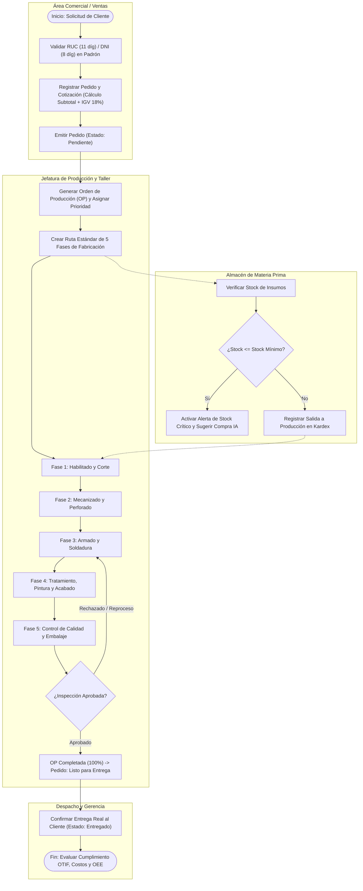
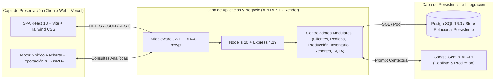
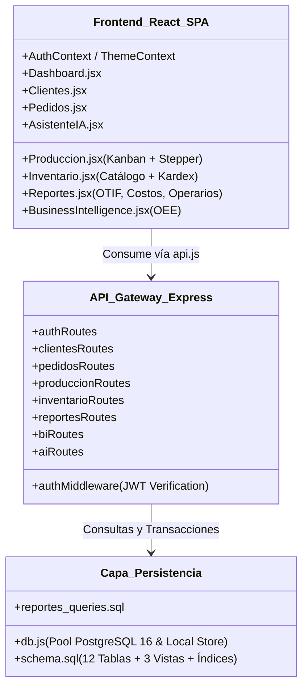
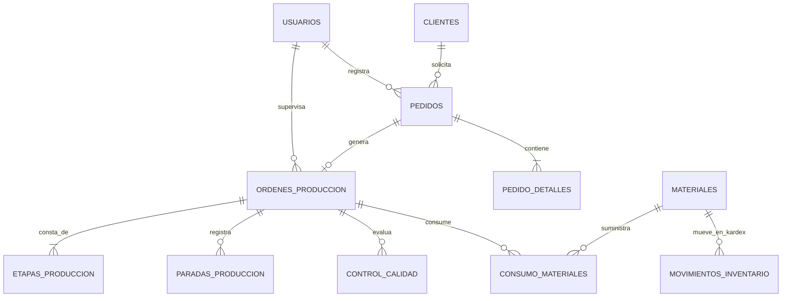
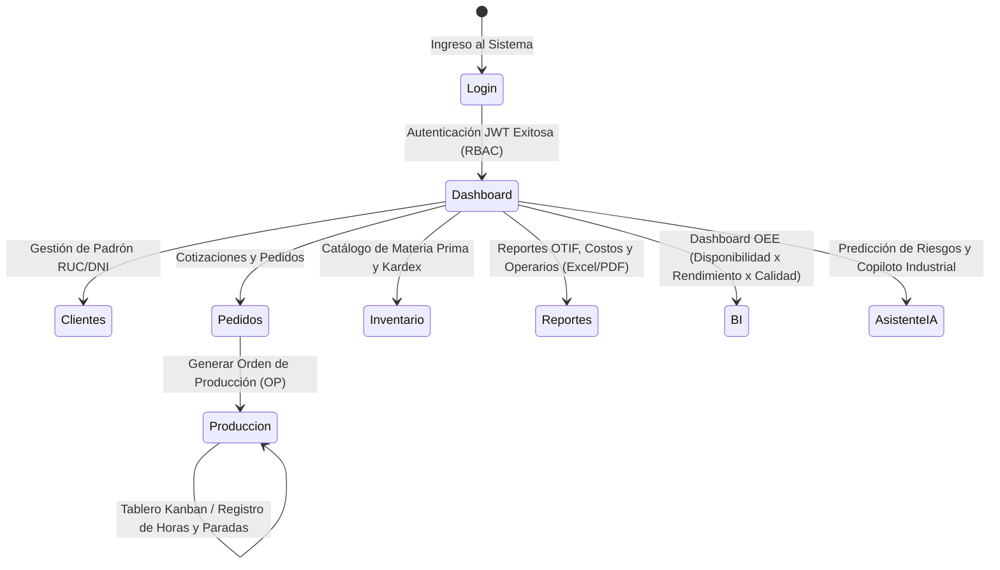

# Fase 2: Diseño del Sistema
## Empresa: RV Vega Servicios Generales E.I.R.L.
**Sistema de Información para la Gestión de la Producción y Pedidos**

---

## 2.1 Análisis del Sistema — Entregable 2.1.1: Modelo de Procesos

### 2.1.1.1 Diagramas de Procesos de Negocio (Notación BPMN / Flujo Operativo)

### 2.1.1.2 Mapeo de Reglas de Negocio (RN)

| Código | Módulo | Regla de Negocio | Implementación Técnica |
| :--- | :--- | :--- | :--- |
| **RN-01** | Clientes | Todo cliente corporativo con **RUC** debe tener exactamente **11 dígitos numéricos**; con **DNI** debe tener exactamente **8 dígitos numéricos**. | Validación Regex en `clientesController.js` y `Clientes.jsx` + `CHECK` en BD. |
| **RN-02** | Clientes | El teléfono móvil de contacto debe tener exactamente **9 dígitos** e iniciar obligatoriamente con el dígito `9`. | Validación `/^9\d{8}$/` en Backend y Frontend. |
| **RN-03** | Pedidos | Todo pedido calcula automáticamente el **Subtotal** ($\sum \text{cantidad} \times \text{precio\_unitario}$), **IGV (18%)** y **Total**. | Calculado en `createPedido` (`pedidosController.js`) y vista previa en `Pedidos.jsx`. |
| **RN-04** | Pedidos | Alertas preventivas de vencimiento: si faltan $\le 3$ días para la `fecha_entrega_prometida`, se marca **Por vencer**; si superó la fecha y no está entregado, se marca **Vencido**. | Función `obtenerAlertaVencimiento` en `Pedidos.jsx` y motor predictivo en `aiService.js`. |
| **RN-05** | Producción | Toda Orden de Producción (OP) genera automáticamente las **5 fases estándar** metalmecánicas y sincroniza el estado del pedido asociado (*En Planificación → En Producción → Listo para Entrega*). | `createOrdenProduccion` y `updateEtapa` en `produccionController.js`. |
| **RN-06** | Producción | El porcentaje de avance de una OP se calcula ponderando las etapas finalizadas ($1.0$) y las etapas en proceso ($0.5$) sobre las 5 fases totales, registrando horas estimadas vs horas reales. | `updateEtapa` y `calcularMetricasTiempos` en `produccionController.js`. |
| **RN-07** | Inventario | Ninguna salida a producción o ajuste negativo puede exceder el `stock_actual` disponible. Si `stock_actual <= stock_minimo`, se activa el estado de **Stock Crítico**. | Validación transaccional en `registrarMovimiento` (`inventarioController.js`). |
| **RN-08** | Reportes / BI | Un pedido cumple **OTIF (On-Time In-Full)** sí y solo si `fecha_entrega_real <= fecha_entrega_prometida`. La meta gerencial de RV Vega es $\ge 90\%$. | `vista_reporte_otif` en SQL y `getReporteOTIF` en `reportesController.js`. |

---

## 2.2 Arquitectura del Diseño Técnico

### 2.2.1 Entregable: Arquitectura del Software

#### 2.2.1.1 Diagrama de Arquitectura del Sistema (Cliente-Servidor Multicapa)

#### 2.2.1.2 Diagrama de Componentes del Software

---

### 2.2.2 Entregable: Script de Base de Datos y Modelo Entidad-Relación

- **Scripts DDL**: Ubicados en [`backend/database/schema.sql`](../backend/database/schema.sql), [`backend/database/seed.sql`](../backend/database/seed.sql) y [`backend/database/reportes_queries.sql`](../backend/database/reportes_queries.sql).

---

### 2.2.3 Entregable: Prototipo de Interfaces y Flujos de Navegación del Usuario

